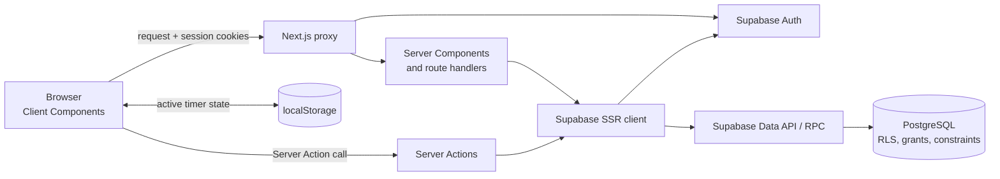

# TimeMetrics Architecture

This document describes the architecture implemented in the current TimeMetrics repository. It focuses on runtime responsibilities, request and data flow, and the boundaries between Next.js, Supabase, and PostgreSQL. The ordered files in [`supabase/migrations`](../supabase/migrations) are the source of truth for database behavior; detailed schema and policy definitions are intentionally outside this document.

## System Overview

TimeMetrics is a server-first Next.js App Router application backed by Supabase Auth and the Supabase Data API. Most reads happen while rendering Server Components. Interactive Client Components hold UI state and invoke Server Actions for mutations. Those reads and writes use the signed-in user's cookie-backed Supabase session rather than a service-role credential, leaving Row Level Security and PostgreSQL constraints active for application traffic.

The live timer is the main exception to server-owned state: an in-progress session is maintained in browser memory and `localStorage`. A new time-block row is inserted only when the user stops the timer or creates a manual entry.

There is no separate application API service or ORM. The only conventional route handler in the core flow is the authentication confirmation callback; product mutations use Server Actions.

## Application Layers

| Layer | Responsibility |
| --- | --- |
| App Router pages and route handlers | Authenticate requests, load page data, compose feature UI, and handle the authentication callback |
| Feature components | Present activities and time blocks; manage forms, dialogs, and timer interaction |
| Server Actions | Validate untrusted inputs, re-check identity and ownership, perform mutations, translate expected database errors, and revalidate affected routes |
| Time and analytics libraries | Provide calendar-date calculations, formatting, profile-timezone validation, timer persistence validation, aggregate construction, and comparison logic |
| Supabase integration | Create cookie-aware server clients, refresh sessions in the request proxy, and provide generated database types |
| PostgreSQL | Store durable data and enforce row ownership, grants, relational integrity, valid profile timezones, valid time ranges, and non-overlap; aggregate reporting data through SQL functions |
| Observability | Capture instrumented authentication, data-access, mutation, rendering, and request errors through Sentry |

The main feature areas are represented by [`src/components/activities`](../src/components/activities), [`src/components/time-blocks`](../src/components/time-blocks), and [`src/components/timer`](../src/components/timer). Cross-cutting logic lives under [`src/lib`](../src/lib) rather than inside presentation components.

## Next.js Application Structure

The core routes are:

| Route | Rendering and responsibility |
| --- | --- |
| `/` | Protected Server Component; dashboard, activity management, timer, manual entry, today's total, and the 20 most recent time blocks |
| `/history` | Protected Server Component; the 100 most recent time blocks grouped by the user's local start date |
| `/analytics` | Protected Server Component; 7- or 30-day analytics and comparison with the preceding equal-length period |
| `/sign-in`, `/sign-up` | Public Server Components whose forms post to authentication Server Actions |
| `/auth/confirm` | Public GET route that verifies a Supabase email OTP and redirects |

The dashboard, history, and analytics pages each call `supabase.auth.getUser()` and redirect unauthenticated requests to `/sign-in`. Protection is therefore explicit at each page rather than centralized in a protected layout. See [`src/app/page.tsx`](../src/app/page.tsx), [`src/app/history/page.tsx`](../src/app/history/page.tsx), and [`src/app/analytics/page.tsx`](../src/app/analytics/page.tsx).

[`src/proxy.ts`](../src/proxy.ts) runs the Supabase session-refresh helper for normal non-static routes. The proxy calls `auth.getClaims()` so expired access tokens can be refreshed and updated cookies returned, but it does not decide which routes are public or redirect unauthorized users.

## Server and Client Responsibilities

### Server-side responsibilities

Server Components and Server Actions own:

- User verification through Supabase Auth.
- Initial activity, time-block, profile-timezone, and analytics reads.
- Input validation that must not rely on browser controls.
- Ownership checks used to produce clear not-found or session-expired responses.
- Durable mutations and route revalidation.
- Reporting-range selection and analytics composition.
- Unexpected error reporting.

The analytics RPC adapter explicitly imports `server-only`, preventing it from being pulled into a browser bundle. See [`src/lib/analytics/get-range-analytics.ts`](../src/lib/analytics/get-range-analytics.ts).

### Client-side responsibilities

Client Components own behavior requiring browser APIs or immediate interaction:

- Timer state, one-second display updates, and `localStorage` persistence.
- Controlled form and dialog state.
- Conversion of `datetime-local` input into JavaScript `Date` values.
- Browser timezone detection.
- Calling Server Actions and presenting their structured results.
- Scoping persisted timer state to the authenticated user and rejecting legacy or foreign-user state during restoration. Normal sign-out also clears persisted timer state as defense-in-depth.

Client Components do not currently query Supabase tables directly. A browser client factory exists in [`src/lib/supabase/client.ts`](../src/lib/supabase/client.ts), but it has no consumers in the implemented application.

## Authentication and Authorization

### Authentication flow

1. The sign-up form posts to the `signUp` Server Action in [`src/app/auth/actions.ts`](../src/app/auth/actions.ts).
2. The action validates the form and calls `supabase.auth.signUp()`.
3. When Supabase inserts the Auth user, a `SECURITY DEFINER` database trigger creates the corresponding application profile with database defaults.
4. Environments requiring email verification can return through [`src/app/auth/confirm/route.ts`](../src/app/auth/confirm/route.ts), which verifies the OTP and redirects to the dashboard. Whether confirmation is required is a Supabase environment setting; local configuration currently disables it. The repository contains the callback handler but not hosted Supabase email-template configuration proving that deployed confirmation messages target this route.
5. Sign-in uses `signInWithPassword()`; the Supabase SSR client writes the resulting session cookies.
6. Subsequent requests pass through the session-refresh proxy, and protected pages verify the user with `getUser()`.
7. Sign-out clears the local timer and calls Supabase sign-out with local scope before redirecting to `/sign-in`.

### Authorization layers

Authorization is deliberately layered:

1. **Page and action identity checks.** Protected pages redirect without a user; each activity, time-block, and timezone mutation calls `getUser()` again.
2. **Explicit query scoping.** Reads and mutations commonly include `user_id = user.id` alongside a record identifier.
3. **PostgreSQL RLS.** Policies scope application rows to `auth.uid()`.
4. **SQL grants.** Later migrations restrict authenticated operations and writable columns, while anonymous roles have no table access.
5. **Constraints, triggers, and foreign keys.** The database independently rejects invalid relationships, profile timezone values, and time ranges.

The Next.js layer improves validation and user-facing errors, but it is not the final trust boundary. The public Supabase credential is designed for client-safe use, so rules that must hold regardless of caller are enforced in PostgreSQL.

No service-role credential is referenced by the application. Service-role and database-owner access remain administrative boundaries outside normal request flow.

## Supabase and Data Access

[`src/lib/supabase/server.ts`](../src/lib/supabase/server.ts) creates a Supabase SSR client from the public project URL, publishable key, and request cookies. It can read cookies in Server Components and write refreshed cookies where the current Next.js execution context allows it. Cookie writes that are not permitted during Server Component rendering are handled by the request proxy instead.

The application uses three data-access styles:

- **Direct page queries** for activities and recent time blocks.
- **Server Action mutations** for activities, time blocks, and profile timezone initialization.
- **SQL RPC calls** for today's time blocks and range analytics.

There is no generalized repository abstraction. Query shapes remain close to the pages or domain actions that use them. This keeps the V1 data path direct, but it also couples those modules to Supabase query semantics.

Page queries add explicit ownership filters even though RLS already filters rows. Dashboard and history reads are bounded to 20 and 100 time blocks respectively; pagination is not implemented.

### Application rules versus database rules

The Server Actions enforce rules that support the product flow and clear error messages, including:

- UUID format checks.
- Required, trimmed activity names with a 100-character application limit.
- Valid parseable timestamps and an end after the start.
- A five-minute tolerance when rejecting future end times.
- A positive timer duration no greater than the wall-clock range.
- Ownership checks for selected activities.
- Browser-supplied timezone validation before profile initialization.

PostgreSQL is responsible for invariants that must remain true independently of the application path:

- Row ownership and permitted operations.
- Valid stored profile timezone values.
- Positive duration and a valid start/end range.
- Duration not exceeding the range.
- Non-overlapping time ranges per user.
- Same-user time-block/activity relationships.
- Per-user activity-name uniqueness.
- Referential and deletion behavior.

Some product rules remain application-only, including the 100-character name limit and future-time restriction. A direct authenticated Data API caller is therefore constrained by the database invariants but does not inherit every Server Action rule.

## Core User and Data Flows

### Activity management

The dashboard renders activities loaded by its Server Component. Client forms and dialogs invoke the create, update, and delete actions in [`src/app/actions/activities.ts`](../src/app/actions/activities.ts). The actions re-check the current user and scope updates or deletes by both activity ID and `user_id`.

Deleting an activity does not delete historical time. PostgreSQL nulls the activity reference on existing time blocks, and the history and analytics layers render those records as `Unlabeled`. If a stopped-but-unsaved timer references a deleted activity, the timer UI asks the user to select a replacement before retrying.

### Timer and time-block lifecycle

The timer in [`src/components/timer/activity-timer.tsx`](../src/components/timer/activity-timer.tsx) has three UI states: idle, running, and paused.

1. **Start.** The user selects an activity. The client records both the overall session start and the current active-segment start with `Date.now()`, then persists versioned timer state scoped to the authenticated user.
2. **Pause.** The client adds the completed segment to accumulated active milliseconds and clears the segment start. Wall-clock time may continue, but active duration does not.
3. **Resume.** A new active segment begins while the original session start is retained.
4. **Stop.** The client closes the final segment, floors active milliseconds to whole seconds, and discards sessions shorter than one second. It constructs a payload containing the full start/end range and the accumulated active duration.
5. **Persist pending save.** Before calling the server, the exact stopped payload is stored in `localStorage`. This allows a failed request to retry without extending or otherwise changing the session.
6. **Server validation.** `createTimeBlock` validates the timestamps and active duration, verifies that the activity belongs to the current user, converts the instants to ISO strings, and inserts the time block.
7. **Database enforcement.** PostgreSQL rechecks its time and tenancy invariants. An overlap exclusion violation is translated into the expected “overlaps an existing session” result.
8. **Completion or retry.** Success clears browser timer state and revalidates the dashboard. Failure leaves the stopped payload available for retry.

The persisted representation is validated on restoration by [`src/lib/time/persisted-timer.ts`](../src/lib/time/persisted-timer.ts). Version 2 payloads include an `ownerUserId`, and a timer is restored only when that owner matches the currently authenticated user. Legacy payloads without ownership information, foreign-user payloads, malformed state, unsupported versions, impossible accumulated time, excessive clock skew, and sessions older than 24 hours are rejected. Invalid, legacy, or foreign-user state is removed from `localStorage` rather than retained across account transitions. Normal sign-out also clears persisted timer state, but ownership validation on restoration is the primary cross-account control. Storage remains best-effort: the in-memory timer continues if browser storage is unavailable.

No in-progress row is created in PostgreSQL. This avoids coordinating partial timer state with the database, but a running timer is local to one browser and is not synchronized across devices. Because the stored time block spans the overall start and end while recording only active seconds, paused gaps are part of the database range used for overlap detection.

### Manual entry and editing

Manual entry begins with browser-local `datetime-local` values. The client parses them as local instants and sends UTC ISO timestamps to `createManualTimeBlock`; the Server Action calculates duration from the range.

The edit dialog follows the same browser-local conversion. If the time range changes, the update action recalculates duration as the elapsed length of the new instant range. If only the activity changes, it preserves the existing duration, which is significant for timer-created sessions whose active duration may be shorter than their total range.

Create, update, and delete actions revalidate the dashboard and, where relevant, history. The authenticated pages read fresh request-specific data; no explicit application caching layer is implemented.

## Analytics Data Flow

Analytics is rendered on the server by [`src/app/analytics/page.tsx`](../src/app/analytics/page.tsx).

1. The page verifies the user and loads the profile timezone.
2. The `range` query parameter is parsed as a supported 7- or 30-day preset; unsupported values fall back to seven days.
3. Calendar helpers calculate a trailing range ending on “today” in the profile timezone.
4. `getPreviousDateRange` constructs an immediately preceding range with the same inclusive day count.
5. Current and previous analytics are requested concurrently through two calls to `getRangeAnalytics`.
6. Each call executes the `get_daily_activity_totals` PostgreSQL function with start date, end date, and timezone.
7. PostgreSQL returns daily per-activity aggregates: local day, activity identity/name, summed stored duration, and session count.
8. `buildRangeAnalytics` fills dates with no rows, computes summary totals and active-day counts, and sorts activity totals.
9. `buildRangeComparison` calculates duration, count, average-session, and per-activity changes across the two equal-length ranges.
10. The Server Component renders the summary tables, activity breakdowns, and the CSS-based daily activity chart.

### RPC boundary

The analytics function is a stable, security-invoker SQL function. It explicitly filters time blocks to `auth.uid()`, and the underlying table reads remain subject to the caller's privileges and RLS. It performs the database-efficient work—filtering and grouping—while TypeScript owns zero filling and presentation-oriented comparison logic.

The dashboard's “today” total uses a second security-invoker function, `time_blocks_for_today`. It selects the signed-in user's blocks whose start instant falls within the current local day; the dashboard sums their stored durations.

Both reporting paths assign a complete time block to the local calendar day containing `started_at`. Sessions are not split across midnight. Activity names reflect the current activity row; deleted activities appear as unlabeled.

## Timezone Strategy

The system distinguishes instants from calendar dates:

- Time-block starts and ends are exchanged as ISO timestamps and stored as PostgreSQL `timestamptz`.
- Profiles store a timezone string, defaulting to `UTC`.
- The browser-supplied initializer validates candidate zones with the shared TypeScript `isAllowedProfileTimezone` rule before attempting an update. Fixed-offset-style and `Etc/*` identifiers are rejected.
- PostgreSQL independently validates stored profile timezone writes through `is_allowed_profile_timezone(text)` and the `profiles_enforce_timezone` trigger. The migration also backfills pre-existing invalid values to `UTC`.
- PostgreSQL and `Intl.DateTimeFormat` do not recognize exactly the same timezone identifiers. `getUserTimezone()` therefore revalidates the stored value on read, reports an invalid stored value to Sentry, and safely falls back to `UTC` if the application runtime rejects it.
- On the dashboard, the client initializer runs only while the effective profile timezone is UTC. It detects `Intl.DateTimeFormat().resolvedOptions().timeZone` and conditionally updates a profile whose stored value is still `UTC`.
- Dashboard and history formatting explicitly use the effective profile timezone.
- Analytics range helpers determine the current calendar date in that timezone, then manipulate date-only values with UTC arithmetic so daylight-saving transitions do not turn a seven-day range into the wrong set of dates.
- PostgreSQL converts the requested local midnight boundaries to instants with `AT TIME ZONE`, making the reporting window follow DST changes in the selected timezone.
- Date-only analytics labels are formatted through synthetic UTC dates so the label itself cannot shift to a neighboring day.

Manual-entry and edit controls use the browser's current timezone because `datetime-local` has no timezone field. Reporting uses the stored profile timezone unless the defensive read path has fallen back to UTC. The two are normally aligned after initialization, but the implementation does not currently provide a timezone settings UI or automatically update a non-UTC profile when the browser timezone later changes.

## Error Handling and Observability

Server Actions return small discriminated success/error results for expected outcomes. Known domain violations such as duplicate activity names or overlapping time blocks are converted into user-facing messages rather than reported as system faults.

Instrumented failures in authentication flows, Server Actions, profile-timezone loading, and analytics RPC access are captured with Sentry operation tags. `getUserTimezone()` additionally emits a warning when the stored timezone fails application-side validation and returns `UTC` as a defensive fallback. Authentication reporting suppresses expected 4xx user-flow errors and records server or status-less failures. The analytics adapter captures RPC failures and throws a generic error, which is handled by the analytics route error boundary. A global error component reports otherwise unhandled rendering errors. Dashboard and history page-query failures receive user-facing fallback states but are not all explicitly captured at their query sites.

Sentry is initialized for browser, Node.js, and edge execution contexts through [`src/instrumentation-client.ts`](../src/instrumentation-client.ts), [`src/instrumentation.ts`](../src/instrumentation.ts), and the root Sentry configuration files when `NEXT_PUBLIC_SENTRY_DSN` is configured. Request errors are connected through `onRequestError`, and client router transitions are instrumented. Performance tracing uses a `tracesSampleRate` of `0.1`, while Sentry Logs are disabled. Deployments without a configured DSN do not initialize Sentry.

## Runtime and Deployment Boundaries

The repository targets Node.js 24 and uses the standard Next.js build and `next start` runtime. GitHub Actions verifies linting, type checking, unit tests, a production build, and a separate local-Supabase database suite. The local Supabase configuration targets PostgreSQL 17.

The repository requires only the public Supabase URL and publishable key for application data access. Sentry configuration is defined separately for client, server, and edge contexts, with initialization controlled by the deployment-provided `NEXT_PUBLIC_SENTRY_DSN` environment variable.

No hosting provider, production Supabase topology, region, SMTP configuration, or deployment workflow is defined in the repository. The presence of Sentry edge configuration does not establish that application pages run at the edge; instrumentation loads the matching configuration when Next.js supplies that runtime.

## Architectural Tradeoffs

- **Server-first data access:** keeping table access in Server Components and Server Actions reduces browser data-access code and centralizes validation, while RLS still protects application-table requests. It also couples page and action modules directly to Supabase because there is no repository layer.
- **Database-centered invariants:** overlap, range validity, ownership, tenancy, and stored timezone validity survive alternative callers and concurrency. This pushes important behavior into migrations and makes local database testing part of architectural verification.
- **Browser-local active timer:** no incomplete database row or background synchronization is required, and failed stops can retry exactly. Persisted state is scoped to the authenticated user and foreign or legacy payloads are discarded rather than carried across accounts. The cost is that active state is device-local, best-effort, deliberately expires, and may be lost during an abnormal account transition.
- **Single-row paused sessions:** active duration can differ from wall-clock range, preserving pause semantics without storing segments. The complete range—not just active segments—participates in overlap prevention.
- **Aggregate SQL plus pure TypeScript shaping:** PostgreSQL filters and groups near the data, while deterministic TypeScript fills gaps and computes comparisons. This avoids transferring raw time blocks for analytics but creates an explicit RPC contract.
- **Profile timezone for reporting:** a stored timezone makes server rendering and SQL agree about calendar boundaries. Database and application runtimes validate independently because PostgreSQL and `Intl.DateTimeFormat` do not recognize exactly the same identifier set; the read-side UTC fallback detects that residual drift. Browser-local editing can still diverge from the profile timezone after travel or manual browser changes.
- **Explicit route guards:** each protected page makes its authentication requirement visible. A future route must remember to add the same guard because the proxy only refreshes sessions.
- **Bounded history reads:** dashboard and history queries are simple and predictable for V1, but there is no pagination for larger histories.

## Key Architectural Decisions

- Use Next.js Server Components for authenticated reads and Server Actions for product mutations.
- Execute application database requests as the signed-in Supabase user so RLS and grants remain active.
- Treat PostgreSQL as the final authority for ownership, tenancy, stored timezone validity, time validity, and overlap prevention.
- Keep an active timer in versioned, user-scoped browser storage and persist only completed sessions.
- Represent pauses as active duration within one overall time range rather than as separate database segments.
- Perform timezone-aware filtering and grouping in SQL, then build complete ranges and comparisons in pure TypeScript.
- Preserve historical time when activities are deleted by allowing unlabeled time blocks.
- Keep deployment-provider assumptions outside the architecture because the repository does not establish them.
