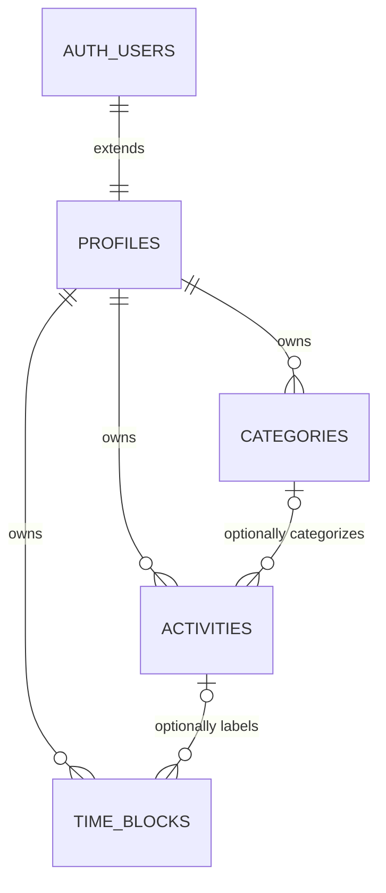

# TimeMetrics Database

This document describes the PostgreSQL schema that TimeMetrics exposes through Supabase. The ordered files in [`supabase/migrations`](../supabase/migrations) are the source of truth. Generated TypeScript types and older standalone SQL references are useful integration artifacts, but they do not override the migrated database state.

For the application-level request and data flow around this database, see [Architecture](./architecture.md).

## Schema at a Glance



`auth.users` is managed by Supabase Auth. The remaining tables live in `public` and are exposed through the Supabase Data API subject to PostgreSQL privileges and Row Level Security (RLS).

### Core tables

| Table         | Responsibility                                                                                                | Important columns                                                                                                                                                                                      |
| ------------- | ------------------------------------------------------------------------------------------------------------- | ------------------------------------------------------------------------------------------------------------------------------------------------------------------------------------------------------ |
| `profiles`    | Application profile keyed one-to-one to a Supabase Auth user; a trigger creates one for each new Auth insert. | `id` is both the primary key and the foreign key to `auth.users.id`. `timezone` is the user's reporting/display timezone and defaults to `UTC`. `plan_id` uses the `plan` enum and defaults to `free`. |
| `categories`  | Optional user-owned grouping records for activities.                                                          | `user_id` identifies the owner; `name` is unique per owner. The current application does not expose category management.                                                                               |
| `activities`  | User-owned labels against which time is tracked.                                                              | `category_id` is nullable. `user_id` is immutable through current client grants.                                                                                                                       |
| `time_blocks` | Completed time sessions.                                                                                      | `started_at` and `ended_at` are absolute instants; `duration_seconds` is stored separately and represents counted activity time. `activity_id` is nullable so history can survive activity deletion.   |

The schema also defines `public.plan` with the values `free` and `pro`. The migrated client grants do not allow authenticated users to read or change `plan_id`, and the current application contains no implemented plan-management flow.

## Relational Structure and Ownership

Every application row is rooted in an Auth user:

* `profiles.id` references `auth.users.id` with `ON DELETE CASCADE`, giving the profile a one-to-one identity relationship with the Auth record.
* `categories.user_id`, `activities.user_id`, and `time_blocks.user_id` reference `profiles.id` with `ON DELETE CASCADE`.
* Deleting an Auth user therefore removes the profile and all of that profile's categories, activities, and time blocks through the foreign-key chain.
* `activities.category_id` references `categories.id` with `ON DELETE SET NULL`. Deleting a category preserves its activities.
* A time block references an activity through the composite key `(activity_id, user_id) -> activities(id, user_id)`. Deleting an activity sets only `activity_id` to null and preserves both the time block and its `user_id`.

The composite time-block relationship was added in [`20260829205816_enforce_time_block_activity_tenancy.sql`](../supabase/migrations/20260829205816_enforce_time_block_activity_tenancy.sql). The accompanying unique constraint on `activities(id, user_id)` exists to provide a valid composite target; `activities.id` remains the primary identity. This relationship prevents a time block from referencing another user's activity even for a privileged write that bypasses RLS. Its insert, update, and deletion behavior is exercised by [`time_blocks_activity_tenancy_test.sql`](../supabase/tests/database/time_blocks_activity_tenancy_test.sql) and [`activity_delete_semantics_test.sql`](../supabase/tests/database/activity_delete_semantics_test.sql).

The category relationship is different: its foreign key checks that the category exists, but it does not encode matching `user_id` values. Same-owner category assignment is enforced for authenticated operations by activity RLS policies, while the current grants prevent clients from writing `category_id` at all. A role that bypasses RLS and has broader table privileges is trusted to maintain this relationship correctly.

The explicit `time_blocks_user_started_at_idx` index orders `started_at` descending within `user_id`. It supports the application's owner-scoped recent/history reads and the user-and-time-window predicates used by reporting. Primary-key and unique constraints supply the other schema indexes.

## Business Invariants

These constraints and trigger-enforced rules are defined by the ordered migrations and remain effective when normal application validation is bypassed.

### Names and identity

* Public entity IDs default to `gen_random_uuid()`; the profile ID instead comes from its Auth user.
* Activity and category names must contain at least one non-whitespace character.
* `(user_id, name)` is unique on both activities and categories. The same name may exist for different users.
* The database does not impose the application's 100-character activity-name limit or normalize surrounding whitespace. Those are application-layer behaviors.

### Completed time blocks

PostgreSQL requires every stored time block to be complete and internally consistent:

* `started_at` and `ended_at` are both required.
* `ended_at` must be strictly later than `started_at`.
* `duration_seconds` must be a positive integer.
* `duration_seconds` cannot exceed the elapsed seconds between the two timestamps.

`duration_seconds` is not derived from the timestamp range. This permits timer-created sessions to record active time that is shorter than the full range because of pauses. Manual sessions normally store the full elapsed duration, but that distinction is an application behavior; PostgreSQL enforces only the valid numeric bounds.

The database does not reject future timestamps, impose a maximum session age, or require an activity. The Server Actions apply additional validation before ordinary application writes.

### Overlap prevention

The `time_blocks_no_overlap` exclusion constraint rejects intersecting time ranges for the same `user_id`:

```text
(user_id WITH =, tstzrange(started_at, ended_at, '[)') WITH &&)
```

The range is half-open: it includes the start and excludes the end. Consequently, one block may start exactly when another ends, while any actual intersection is rejected. The rule applies across all activities and also to unlabeled blocks. Different users may have identical ranges.

The exclusion operates on the entire start/end range, not `duration_seconds`, so paused gaps inside a timer session still reserve that range against overlap. It is enforced on both inserts and updates and produces PostgreSQL exclusion-violation code `23P01`, which the application translates into a user-facing overlap error in [`src/app/actions/time-blocks.ts`](../src/app/actions/time-blocks.ts).

The constraint depends on the `btree_gist` extension, created in the `extensions` schema by the baseline migration. It supplies the GiST equality operator support needed to combine `user_id` equality with timestamp-range overlap.

## Profile Creation and Maintenance

`on_auth_user_created` is an `AFTER INSERT` trigger on `auth.users`. It calls `public.handle_new_user()`, which inserts a matching profile ID and lets database defaults initialize:

* `plan_id` to `free`
* `timezone` to `UTC`
* creation/update timestamps to the current database time

`handle_new_user` is `SECURITY DEFINER`, has an empty `search_path`, and fully qualifies its table reference. This lets the Auth trigger create the profile despite profile RLS without exposing profile creation as a client operation. Direct client execution is revoked; because the function returns `trigger`, it is used through its trigger rather than as an application RPC. Profile isolation and automatic creation are verified in [`profiles_rls_test.sql`](../supabase/tests/database/profiles_rls_test.sql).

Profile timezone writes are additionally protected by `profiles_enforce_timezone`, a `BEFORE INSERT OR UPDATE OF timezone` trigger. It calls the security-invoker `enforce_profile_timezone()` trigger function, which delegates validation to `is_allowed_profile_timezone(text)` and raises SQLSTATE `22023` with the stable message `invalid profile timezone` when the value is rejected.

Because the trigger function is `SECURITY INVOKER`, a role that writes `profiles.timezone` must also be able to execute `is_allowed_profile_timezone(text)`. The hardened routine policy explicitly grants that helper to `authenticated`, the current application role that writes `profiles.timezone`. Future database roles granted profile-timezone write access must receive the matching validator privilege as part of that grant change.

Each public table has a `BEFORE UPDATE` trigger that calls `set_updated_at()` and replaces `updated_at` with `now()`. IDs, creation timestamps, and update timestamps are not client-writable under the hardened grants. The trigger function itself requires no direct client `EXECUTE`; it remains usable through the database trigger relationship.

## Timestamp and Timezone Storage

All event and audit timestamps use PostgreSQL `timestamptz`, so stored values represent instants rather than timezone-free local clock readings. Local calendar interpretation happens only when data is queried or displayed.

`profiles.timezone` is non-null text with a `UTC` default. The application validates browser-detected values with `Intl.DateTimeFormat` and rejects fixed-offset-style and `Etc/*` identifiers before profile initialization. PostgreSQL independently protects the stored value through `is_allowed_profile_timezone(text)` and the `profiles_enforce_timezone` trigger. The validator rejects the same fixed-offset and `Etc/*` forms case-insensitively and probes PostgreSQL timezone resolution with `AT TIME ZONE`; unsupported values are rejected before they can be persisted.

[`20260831225632_enforce_profile_timezone_invariant.sql`](../supabase/migrations/20260831225632_enforce_profile_timezone_invariant.sql) also backfills any pre-existing row that fails the database validator to `UTC` before installing the trigger. The application retains a defensive read-side validator because PostgreSQL and `Intl.DateTimeFormat` do not recognize exactly the same identifier set. If the application runtime rejects a stored value that PostgreSQL accepted, `getUserTimezone()` reports a warning to Sentry and returns `UTC` rather than allowing timezone-dependent rendering or analytics to fail.

The reporting functions accept timezone text explicitly. They turn local midnight boundaries into instants inside PostgreSQL, so daylight-saving transitions are handled by the database timezone rules rather than by assuming every local day is 24 hours.

## Security Invariants

Database API access is layered:

1. **SQL privileges** determine which relations, operations, columns, and routines a role can attempt.
2. **RLS policies** restrict permitted rows to the identity returned by `auth.uid()`.
3. **Constraints, triggers, and foreign keys** preserve relational and business invariants regardless of the calling user's identity.

The final client-facing table grants are defined by [`20260830233759_harden_client_table_grants.sql`](../supabase/migrations/20260830233759_harden_client_table_grants.sql) and verified exhaustively by [`table_grants_test.sql`](../supabase/tests/database/table_grants_test.sql).

The final public-routine execution policy is defined by [`20260901051250_harden_function_privileges.sql`](../supabase/migrations/20260901051250_harden_function_privileges.sql) and verified by [`function_grants_test.sql`](../supabase/tests/database/function_grants_test.sql).

### Client-facing table privileges

| Table         | `anon`                        | `authenticated`                                                                         |
| ------------- | ----------------------------- | --------------------------------------------------------------------------------------- |
| `profiles`    | No table or column privileges | Select `id` and `timezone`; update `timezone` only                                      |
| `categories`  | No table or column privileges | Select `id` and `user_id` only, which the activity policies need for ownership checks   |
| `activities`  | No table or column privileges | Select and delete; insert `user_id`/`name`; update `name`                               |
| `time_blocks` | No table or column privileges | Select and delete; insert owner/activity/range/duration; update activity/range/duration |

This column scoping prevents an authenticated client from supplying database-controlled IDs or audit timestamps, reassigning existing activities or time blocks to another user, modifying `plan_id`, or writing the currently unused activity category link. Anonymous table denial is tested in [`anon_access_test.sql`](../supabase/tests/database/anon_access_test.sql).

Default table privileges for objects subsequently created by `postgres` in `public` are also revoked from `anon` and `authenticated`. This prevents a future table from becoming client-accessible merely because it was created.

### Routine execution privileges

Direct execution of routines in `public` follows a default-deny allowlist:

| Role             | Direct `EXECUTE` on current `public` routines                                                                   |
| ---------------- | --------------------------------------------------------------------------------------------------------------- |
| `PUBLIC`         | None                                                                                                            |
| `anon`           | None                                                                                                            |
| `authenticated`  | `get_daily_activity_totals(date,date,text)`, `time_blocks_for_today(text)`, `is_allowed_profile_timezone(text)` |
| `service_role`   | None                                                                                                            |
| `postgres` owner | Owner privileges remain                                                                                         |

The hardening migration first revokes `EXECUTE` on all existing routines in `public` from `PUBLIC`, `anon`, `authenticated`, and `service_role`, then explicitly re-grants only the three routines required by authenticated application workflows.

Internal database routines remain usable through their trigger relationships without being exposed as direct client RPCs:

* `handle_new_user()`
* `rls_auto_enable()`
* `set_updated_at()`
* `enforce_profile_timezone()`

This policy is tested schema-wide rather than through individual deny assertions, so newly added public routines are also covered by the current-role checks.

### Future routine default privileges

Routine hardening also changes what happens when `postgres` creates future routines.

There are two separate default-privilege sources:

1. PostgreSQL normally gives new routines `EXECUTE` to `PUBLIC`. A global `ALTER DEFAULT PRIVILEGES FOR ROLE postgres` revoke removes that built-in execution default for routines created by `postgres`.
2. The baseline added schema-scoped defaults in `public` that granted execution to `anon`, `authenticated`, and `service_role`. A separate `IN SCHEMA public` revoke removes those defaults.

The split is intentional: global and schema-scoped default privileges are distinct PostgreSQL catalog entries, and a schema-scoped revoke cannot subtract PostgreSQL's built-in global `PUBLIC EXECUTE` default.

Default privileges are tied to the role creating the object. These rules therefore cover routines created by `postgres`, which matches this repository's migration workflow. Routines created by another role use that role's own default privilege policy.

The global `postgres` rule applies beyond `public`. Future routines created by `postgres` in another schema—including extension-installed routines created under that role—also begin without PostgreSQL's built-in `PUBLIC EXECUTE` unless their installation establishes its own privileges. A future workflow that requires direct execution must grant it explicitly.

`function_grants_test.sql` regression-tests these defaults by creating a transactional probe function while running as `postgres` and verifying that `PUBLIC`, `anon`, `authenticated`, and `service_role` receive no effective execution privilege.

### Row Level Security

RLS is enabled on all four public tables. Policies use the authenticated JWT identity exposed by `auth.uid()`:

| Table         | Policy behavior                                                                                                                                                                                                                                                                               |
| ------------- | --------------------------------------------------------------------------------------------------------------------------------------------------------------------------------------------------------------------------------------------------------------------------------------------- |
| `profiles`    | Select the row whose `id` is the current user. An insert policy permits only the user's own `free` profile, although current grants leave creation to the Auth trigger. Update permits only the user's own row; column grants narrow that operation to `timezone`. There is no delete policy. |
| `categories`  | Select, insert, update, and delete policies require `user_id = auth.uid()`. Current grants expose only the two columns needed for ownership lookup, so category writes are unavailable to clients.                                                                                            |
| `activities`  | CRUD policies require ownership. Insert/update checks also require any referenced category to belong to the current user.                                                                                                                                                                     |
| `time_blocks` | CRUD policies require ownership. Insert/update checks also require any referenced activity to belong to the current user.                                                                                                                                                                     |

For updates, `USING` controls which existing rows are visible to the operation and `WITH CHECK` validates the resulting ownership/linkage. Reads and writes against another user's rows are therefore filtered or rejected even when the query omits an explicit `user_id` condition. The repository verifies profile, activity, and time-block behavior in [`profiles_rls_test.sql`](../supabase/tests/database/profiles_rls_test.sql), [`activities_rls_test.sql`](../supabase/tests/database/activities_rls_test.sql), [`time_blocks_rls_test.sql`](../supabase/tests/database/time_blocks_rls_test.sql), and [`rls_ownership_test.sql`](../supabase/tests/database/rls_ownership_test.sql).

An `ensure_rls` event trigger calls `rls_auto_enable()` after public tables are created and attempts to enable RLS automatically. The database test harness also asserts that every current public table has RLS enabled in [`rls_harness_test.sql`](../supabase/tests/database/rls_harness_test.sql).

RLS is not marked `FORCE ROW LEVEL SECURITY`. PostgreSQL table owners, superusers, and Supabase's privileged `service_role` remain trusted database boundaries capable of bypassing RLS where their underlying privileges allow it. User-facing requests therefore run as `authenticated`, not with a service-role credential. The application does not reference a service-role key. Relational/check/exclusion constraints and profile-timezone triggers continue to apply to privileged writes, but RLS-only ownership checks do not.

## Database Functions and RPCs

### `is_allowed_profile_timezone`

`is_allowed_profile_timezone(candidate text)` is a `STABLE`, security-invoker PL/pgSQL helper with an empty `search_path`. It is the database-side definition used both to repair existing profile timezone values during migration and to validate future profile writes.

The function:

1. rejects null input;
2. rejects fixed-offset-style forms such as `UTC+05:00`, `GMT-04:00`, and bare `+05:00`;
3. rejects `Etc/*` identifiers case-insensitively; and
4. probes PostgreSQL timezone resolution with `AT TIME ZONE`, returning false on `invalid_parameter_value`.

PostgreSQL and `Intl.DateTimeFormat` intentionally remain separate validators because their recognized timezone sets are not identical. The application read-side fallback detects that residual cross-runtime drift rather than assuming the two sets are provably equal.

Direct execution is available only to `authenticated`, because the security-invoker `enforce_profile_timezone()` trigger function calls this helper during authenticated writes to `profiles.timezone`. `PUBLIC`, `anon`, and `service_role` have no direct execution grant.

### `enforce_profile_timezone`

`enforce_profile_timezone()` is a security-invoker trigger function with an empty `search_path`. It calls `is_allowed_profile_timezone(new.timezone)` and raises SQLSTATE `22023` with message `invalid profile timezone` when validation fails. The rejected value is placed in PostgreSQL's `DETAIL` field rather than interpolated into the stable message.

Direct execution is revoked from `PUBLIC`, `anon`, `authenticated`, and `service_role`; clients use it only through the `profiles_enforce_timezone` trigger.

### `get_daily_activity_totals`

`get_daily_activity_totals(p_start_date date, p_end_date date, p_time_zone text)` is the analytics RPC called by [`get-range-analytics.ts`](../src/lib/analytics/get-range-analytics.ts). It is a `STABLE`, security-invoker SQL function with an empty `search_path`.

The function:

1. converts the inclusive local date range into a half-open instant range, from local midnight on `p_start_date` to local midnight after `p_end_date`;
2. filters time blocks explicitly to `auth.uid()` and to blocks whose `started_at` falls inside that range;
3. derives each block's local date with `started_at AT TIME ZONE p_time_zone`;
4. groups by local day and activity;
5. returns summed stored duration and session count, ordered by day and descending duration.

The activity join is left-sided. A time block whose activity was deleted remains in analytics with null activity identity/name. Names come from the current activity row, not from a historical snapshot.

Blocks are attributed wholly to the local day containing `started_at`; the function does not split sessions at midnight. It emits only groups that contain data—the Next.js analytics layer fills empty dates and calculates comparisons.

Because the function is security-invoker, it retains the caller's underlying table privileges and RLS restrictions. Only `authenticated` receives direct execution through the application allowlist. `anon` is rejected at the function boundary before the function can attempt an underlying `time_blocks` read. This runtime boundary and per-user output are tested in [`daily_activity_totals_rls_test.sql`](../supabase/tests/database/daily_activity_totals_rls_test.sql).

### `time_blocks_for_today`

`time_blocks_for_today(p_tz text)` is a `STABLE`, security-invoker SQL function used by the dashboard in [`src/app/page.tsx`](../src/app/page.tsx). It returns the current user's complete time-block rows whose `started_at` falls between today's local midnight and the next local midnight in `p_tz`, newest first. The UI sums `duration_seconds` from those rows.

As with the range analytics function, “today” is based on the block's start instant rather than splitting a cross-midnight block. Direct execution is granted only to `authenticated` under the current application routine policy.

Neither reporting function escalates privileges. Both use explicit `auth.uid()` filters in addition to the RLS applied to their underlying table reads.

## Triggers and Extensions

| Object                      | Role                                                                                                   |
| --------------------------- | ------------------------------------------------------------------------------------------------------ |
| `extensions.btree_gist`     | Enables the mixed UUID-equality/timestamp-range GiST exclusion constraint used for overlap prevention. |
| `on_auth_user_created`      | Creates a public profile after a Supabase Auth user is inserted.                                       |
| `profiles_enforce_timezone` | Validates profile timezone values before insert and when `timezone` is updated.                        |
| `set_*_updated_at`          | Maintains `updated_at` before updates on every public application table.                               |
| `ensure_rls`                | Automatically enables RLS after a table is created in `public`.                                        |

The trigger functions pin their `search_path` (`''` for application helpers and `pg_catalog` for `rls_auto_enable`) rather than relying on caller-controlled name resolution.

The currently installed extensions live outside `public`, including `btree_gist` in the `extensions` schema. The current schema-wide `public` routine revoke therefore targets application-owned routines rather than existing extension routines in `public`.

## Migration Strategy

The current schema is an ordered baseline plus four hardening migrations:

1. [`20260828161747_baseline.sql`](../supabase/migrations/20260828161747_baseline.sql) establishes the complete initial schema, functions, triggers, policies, grants, index, enum, and extension.
2. [`20260829205816_enforce_time_block_activity_tenancy.sql`](../supabase/migrations/20260829205816_enforce_time_block_activity_tenancy.sql) replaces the single-column activity foreign key with the composite owner-aware relationship.
3. [`20260830233759_harden_client_table_grants.sql`](../supabase/migrations/20260830233759_harden_client_table_grants.sql) narrows existing table/column privileges and revokes permissive default table grants for future objects.
4. [`20260831225632_enforce_profile_timezone_invariant.sql`](../supabase/migrations/20260831225632_enforce_profile_timezone_invariant.sql) backfills invalid profile timezone values, installs the shared database validator, and rejects future invalid timezone writes through a trigger.
5. [`20260901051250_harden_function_privileges.sql`](../supabase/migrations/20260901051250_harden_function_privileges.sql) revokes unnecessary execution on existing public routines, establishes the authenticated routine allowlist, and hardens future routine defaults for objects created by `postgres`.

[`supabase/config.toml`](../supabase/config.toml) enables migrations and targets PostgreSQL 17 for local development. The earlier standalone files [`docs/schema.sql`](./schema.sql), [`docs/rls-policies.sql`](./rls-policies.sql), and [`docs/auto_create_profile_on_signup.sql`](./auto_create_profile_on_signup.sql) do not represent the final cumulative state—for example, they predate completed-only time blocks, profile timezone updates, the composite tenancy foreign key, hardened table and routine grants, and database-enforced timezone validity. They should not be used to provision the current database.

## Database Guarantees

Under the migrated schema, PostgreSQL itself guarantees that:

* every application row belongs to an existing profile, and every profile belongs to an Auth user;
* deleting an Auth user cascades through that user's application data;
* authenticated table access is row-isolated by `auth.uid()` and anonymous roles have no table access;
* client column grants prevent ownership reassignment, audit-field writes, plan changes, and category-link writes;
* direct execution of current public routines is deny-by-default, with `authenticated` limited to the three routines required by implemented application workflows;
* `PUBLIC`, `anon`, and `service_role` have no direct execution on current application-owned public routines;
* future routines created by `postgres` do not automatically inherit PostgreSQL's built-in `PUBLIC EXECUTE` or the baseline's `public`-schema execution grants for `anon`, `authenticated`, and `service_role`;
* stored profile timezone values satisfy the database-side TimeMetrics timezone policy, and invalid legacy values are repaired to `UTC` when the invariant migration is applied;
* a time block cannot reference an activity owned by another user, even when RLS is bypassed;
* activity deletion preserves historical time blocks and only removes their activity label;
* stored time blocks are complete, positive-duration ranges whose counted duration does not exceed elapsed time;
* one user's time-block ranges cannot overlap, while exactly adjacent ranges are allowed;
* per-user activity and category names are nonblank and unique;
* analytics RPCs execute with caller privileges, explicitly filter to `auth.uid()`, and use timezone-aware local-day boundaries;
* anonymous analytics calls are rejected at the function boundary rather than reaching the underlying time-block table; and
* public tables created later by `postgres` inherit no default `anon` or `authenticated` table privileges, and their creation triggers an automatic attempt to enable RLS.
